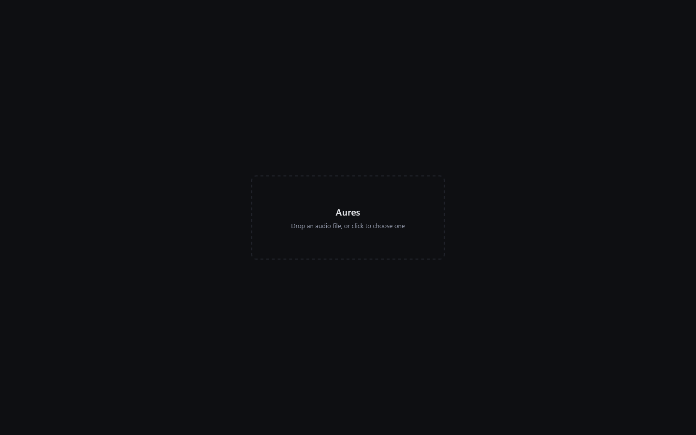
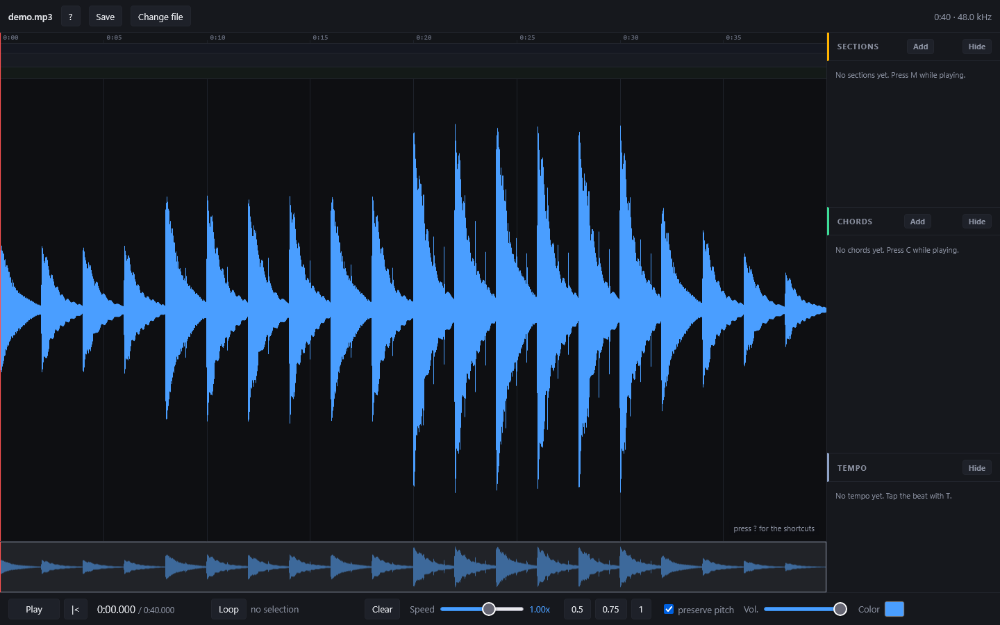
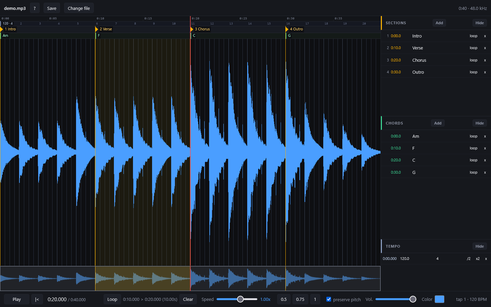

# Getting started

Open https://memoriainfinita.github.io/aures/ in Chrome or Firefox.

Drop an audio file on the page, or click it to choose one. aures can also be run offline: download `index.html` and open it, that is the whole installation.

## The screen

- The waveform fills the page, with an overview strip under it that shows where you are in the song
- The panel on the right lists the **Sections**, **Chords** and **Tempo** you add; each has an **Add** and a **Hide** button
- The bar at the bottom has play, back to start, the loop controls, the speed, the pitch option, the volume and a colour picker

## Move around

- The wheel zooms at the cursor, Shift+wheel pans, and `0` fits the whole song; up and down also zoom
- Click the waveform to seek there; `K` or space plays and pauses; `J` and `L` seek back and forward 5 s (Shift 1 s, Alt 0.1 s)
- Drag along the overview strip to move the view

## Loop a passage

Drag over the waveform to make a loop; it starts playing at once. Drag its edges to adjust them, or nudge them in 20 ms steps with `,` `.` and `<` `>`. `I` and `O` set the in and out at the playhead, and `R` turns the loop on and off. **Clear** removes it.

## Slow it down

The speed goes from 0.25x to 1.5x, with the slider, `+` and `-`, or the 0.5, 0.75 and 1 buttons. **preserve pitch** keeps a slowed passage in tune; below about 0.5x the browser's time-stretching starts to sound metallic.

Next: [Marking a song](marking.md).
