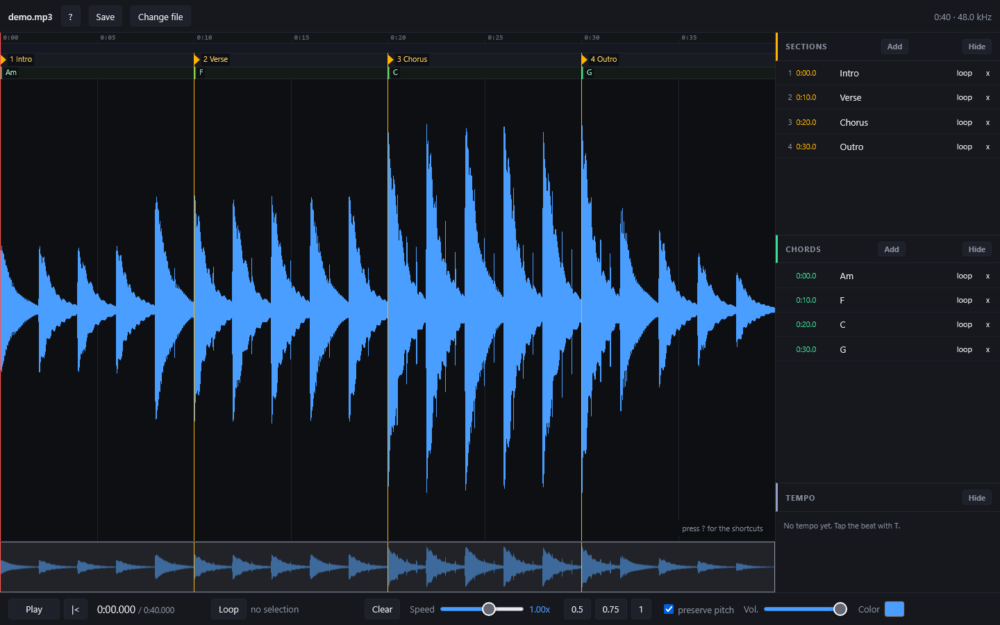
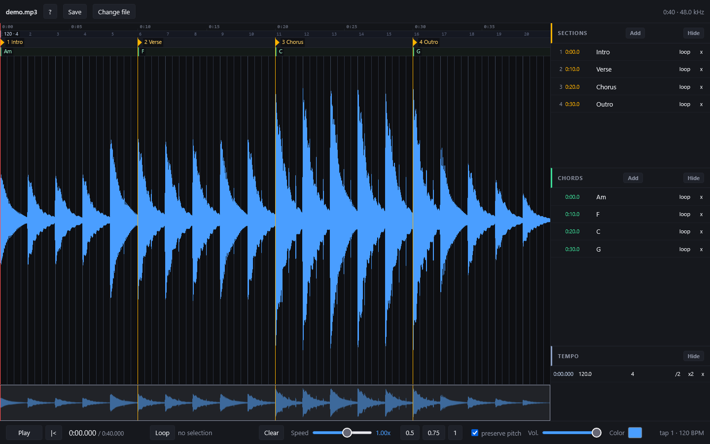

# Marking a song

## Sections and chords

- Press `M` to add a section marker at the playhead and `C` to add a chord marker. The new marker takes the focus so you can name it straight away; Enter or Esc leaves the field
- The markers have their own lanes above the waveform, and a list on the right with their times. Drag a marker to move it, rename it in the list, and remove it with the x
- Double-click a marker, or press **loop** in its row, to loop from there to the next one: the quickest way to drill one chord change or a bar you keep missing
- `1` to `9` jump to the section with that number
- **Hide** a lane, or press `Shift+M`, `Shift+C` or `Shift+T`, and its height goes back to the waveform

## A bar grid

Tap the beat with `T`. The tempo appears in its lane and a grid of bars is drawn over the waveform.

- Drag the grid's anchor to line it up with a song whose intro does not start on beat one
- Drop more anchors wherever the song changes tempo or metre; `/2` and `x2` in the tempo lane halve and double a value
- The grid is a guide to read against, never a magnet: your markers stay where you put them

## Mistakes

`Ctrl+Z` undoes and `Ctrl+Shift+Z` redoes, for markers and tempo anchors. A mistaken delete costs one key, not an evening.

Next: [Saving](saving.md).
